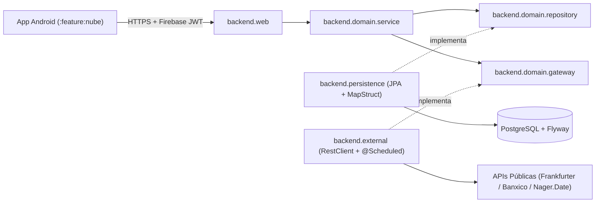

# Arquitectura · `backend`

Servicio REST de **Finanzas** (consumido únicamente por el flavor `nube`, manteniendo el flavor `privada` 100% sin internet según `D-020`).

Arquitectura hexagonal ligera en **Java 21, Spring Boot 4, PostgreSQL, MapStruct y OpenAPI**, equipada con seguridad **Firebase JWT**, migraciones **Flyway**, validación `@Valid` y un adaptador `external/` para APIs públicas con caché y respaldo en PostgreSQL.

## Capas y regla de dependencias

Todo el código vive bajo el paquete base `backend`:

| Paquete | Responsabilidad | Depende de |
|---|---|---|
| `backend.web` | Controladores REST, DTOs con `@Valid`, `SecurityConfig` (Firebase JWT), `CorsConfig`, `OpenApiConfig`, `GlobalExceptionHandler` (`ProblemDetail`) | `backend.domain` |
| `backend.domain` | Modelos de dominio, excepciones, puertos `repository` (PostgreSQL) y `gateway` (APIs externas), y servicios de casos de uso | nada (sin JPA, sin HTTP) |
| `backend.persistence` | Entidades JPA, Spring Data repositories, mappers MapStruct y adaptadores que implementan `backend.domain.repository` | `backend.domain` |
| `backend.external` | Clientes `RestClient` hacia APIs públicas (Frankfurter, Banxico SIE, Nager.Date) y tareas `@Scheduled` | `backend.domain` |

## Principios clave

1. **Privacidad primero (`D-020`):** el backend nunca almacena movimientos, saldos ni deudas personales en texto plano. Solo gestiona catálogo público, datos de mercado/calendario, perfil mínimo (`firebase_uid`) y, opcionalmente, archivos `.respaldo` ya cifrados con AES-256-GCM en el teléfono.
2. **Autenticación sin contraseñas locales:** Spring Security valida el `Firebase ID Token` contra las llaves públicas JWKS de Google (`iss`, `aud`, `exp`, `sub`).
3. **Resiliencia ante APIs externas:** las consultas a APIs públicas corren con timeouts cortos (`5 s` conexión, `8 s` lectura) y se cachean en PostgreSQL; si un proveedor cae, el servicio responde con el último dato válido almacenado.
4. **Esquema versionado:** `spring.jpa.hibernate.ddl-auto=validate` obliga a que toda evolución pase por migraciones Flyway (`src/main/resources/db/migration`).

## Sincronización y catálogo

- **Sincronización de mercado:** `SincronizacionMercadoScheduler` actualiza divisas e indicadores una vez al día, de lunes a viernes, según `finanzas.scheduling.mercado-cron` (por defecto `0 0 13 * * MON-FRI`, zona `America/Mexico_City`, después de la publicación del FIX de Banxico). Los días inhábiles del año actual y del siguiente se aseguran el día 1 de cada mes. Con `finanzas.scheduling.enabled=false` (pruebas) no se programa ninguna tarea.
- **Productos verificados:** `producto_financiero.verificado` (migración `V3`, `NOT NULL DEFAULT FALSE`) indica que un administrador revisó los datos contra la fuente oficial. Se expone como `verificado` en el JSON de productos y se administra desde `/api/v1/admin/productos`. En el alta, si se omite, queda en `false`. En la edición, si se omite, se conserva el valor actual. El catálogo de ejemplo queda sin verificar.
